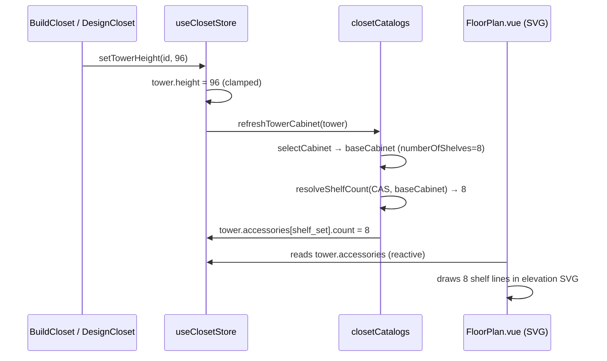

# Cabinet Shelf Count in Elevation View — Implementation Plan

## Goal Description

The elevation view currently renders a **fixed number of shelves** (hardcoded `count: 5` in `accessoriesForCategory`) regardless of the cabinet's height. The actual shelf count should be **driven by `numberOfShelves`** from the resolved cabinet record (API data), which varies based on height tier:

| CAS height tier | Shelves |
|-----------------|---------|
| ≤ 90"           | 7       |
| 90" – 96"       | 7       |
| > 96"           | 8       |

This applies to **all shelf-bearing categories**: CAS, CCS (corner shelves), and CSS (shoe shelves).

### How the System Currently Works

```
createTowerFromCategory()
  └─ accessoriesForCategory(categoryCode)   ← returns count:5 hardcoded
        └─ { type: 'shelf_set', count: 5 }

setTowerHeight()
  └─ refreshTowerCabinet(tower)             ← resolves the cabinet record (w/ numberOfShelves)
        └─ does NOT sync shelf count back to accessories
```

The `ClosetCabinetEntry.numberOfShelves` field is already fetched from the API and stored — it just isn't applied back to the tower's accessories.

The elevation SVG renderer at `FloorPlan.vue:989-1008` reads `acc.count` from `tower.accessories` to draw shelves. So the fix is to keep that count **in sync** with the resolved cabinet's `numberOfShelves`.

---

## User Review Required

> [!IMPORTANT]
> **Shelf count is user-editable** today (via a slider in `DesignCloset.vue`). After this change, the count will be **automatically reset** whenever the user changes height. If the user had manually adjusted shelf count, that customization will be lost on height change. This is the intended behavior per the `/plan` spec ("automatically update when height changes"), but confirm this is correct.

> [!WARNING]
> The constraint validator in `validateCloset.ts` currently allows shelves `0–10`. The API `numberOfShelves` must stay within this range (currently 7–8 for CAS — well within bounds). No change needed to constraints, but worth monitoring if other catalogs add unusual counts.

---

## Open Questions

> [!IMPORTANT]
> **What is the CSS (Shoe Shelf) count rule?** The user said "all categories that use shelves, including CSS." CSS uses `shoe_shelf` accessories (not `shelf_set`). Should CSS shoe shelf count also be driven by `numberOfShelves` from the API cabinet record? If the API returns `numberOfShelves=0` for CSS, we would fall back to the existing default. Please confirm.

---

## Proposed Changes

### Component: `closetCatalogs.ts` — Shelf count resolution helper

#### [MODIFY] `closetCatalogs.ts`

Add a new **exported** helper that picks the correct shelf count for a tower, given its resolved cabinet:

```ts
/**
 * Returns the shelf count to use for a tower based on the resolved cabinet
 * record's numberOfShelves field. Falls back to category-level defaults if the
 * cabinet record is missing or has numberOfShelves === 0.
 */
export function resolveShelfCount(
  categoryCode: ClosetCatalogCategoryCode,
  cabinet: ClosetCabinetEntry | null | undefined,
): number {
  // Use API value when available and non-zero
  if (cabinet && cabinet.numberOfShelves > 0) {
    return cabinet.numberOfShelves;
  }
  // Fallback defaults (matches existing hardcoded behaviour)
  switch (categoryCode) {
    case 'CAS':
    case 'CCS':
      return 5;
    case 'CSS':
      return 5; // shoe shelves fallback
    default:
      return 0;
  }
}
```

Also update `accessoriesForCategory` to accept an **optional cabinet** parameter so new towers start with the correct count:

```diff
 function accessoriesForCategory(
   categoryCode: ClosetCatalogCategoryCode,
+  cabinet?: ClosetCabinetEntry | null,
 ): Accessory[] {
   switch (categoryCode) {
     ...
     case 'CAS':
     case 'CCS':
-      return [{ type: 'shelf_set', count: 5 }];
+      return [{ type: 'shelf_set', count: resolveShelfCount(categoryCode, cabinet) }];
     case 'CSS':
-      return [{ type: 'shoe_shelf', count: 5 }];
+      return [{ type: 'shoe_shelf', count: resolveShelfCount(categoryCode, cabinet) }];
   }
 }
```

And thread `cabinet` through in `createTowerFromCategory`:

```diff
-    accessories: accessoriesForCategory(categoryCode),
+    accessories: accessoriesForCategory(categoryCode, cabinet),
```

---

### Component: `closetCatalogs.ts` — Sync shelf count in `refreshTowerCabinet`

#### [MODIFY] `closetCatalogs.ts` — `refreshTowerCabinet` function

After resolving the base cabinet, sync the `shelf_set` (or `shoe_shelf`) count on the tower's accessories:

```diff
 export function refreshTowerCabinet(tower: Tower, options?: { catalogSwitched?: boolean }): void {
   ...
   const baseCabinet = selectCabinet(...);
   tower.cabinetId = baseCabinet?.id;
   tower.cabinetCode = baseCabinet?.code;
+
+  // Sync shelf count from resolved cabinet's numberOfShelves
+  const shelfCount = resolveShelfCount(tower.categoryCode ?? 'CAS', baseCabinet);
+  if (shelfCount > 0) {
+    const isShelfCategory =
+      tower.categoryCode === 'CAS' ||
+      tower.categoryCode === 'CCS';
+    const isShoeCategory = tower.categoryCode === 'CSS';
+
+    if (isShelfCategory) {
+      const idx = tower.accessories.findIndex((a) => a.type === 'shelf_set');
+      if (idx >= 0) {
+        tower.accessories[idx] = { type: 'shelf_set', count: shelfCount };
+      }
+    } else if (isShoeCategory) {
+      const idx = tower.accessories.findIndex((a) => a.type === 'shoe_shelf');
+      if (idx >= 0) {
+        (tower.accessories[idx] as ShoeShelfAccessory).count = shelfCount;
+      }
+    }
+  }
   ...
 }
```

This runs automatically because `setTowerHeight()` already calls `refreshTowerCabinet()`.

---

### Component: Constraint update

#### [MODIFY] `constraints.ts`

Raise the shelf max from 10 to allow for future API values up to ~12:

```diff
 export const ACCESSORY_CONSTRAINTS = {
-  shelves: { min: 0, max: 10 },
+  shelves: { min: 0, max: 12 },
```

(Optional — only needed if API returns > 10 shelves for taller cabinets.)

---

## Data Flow Diagram



---

## Verification Plan

### Automated Tests

```bash
npm test
```

Key tests to watch:
- `tests/floorPlan.pivot.integration.test.ts` — must still pass (we don't touch geometry)
- `tests/floorPlan.addItems.selection.integration.test.ts` — accessories array changes must not break

### Manual Verification

1. Open the app at `/closet/build`
2. Add a **CAS (Shelves)** tower, height 84" → elevation view must show **7 shelves**
3. Change height to 90" → must still show **7 shelves**
4. Change height to 96" → must show **8 shelves**
5. Add a **CCS (Corner Shelves)** tower and confirm same behavior
6. Add a **CSS (Shoe Shelves)** tower and confirm shoe shelf count updates
7. Confirm the shelf count slider in `DesignCloset.vue` reflects the new default count
8. Run `npm run build` to confirm no TypeScript errors

### Build Check

```bash
npm run build
```
