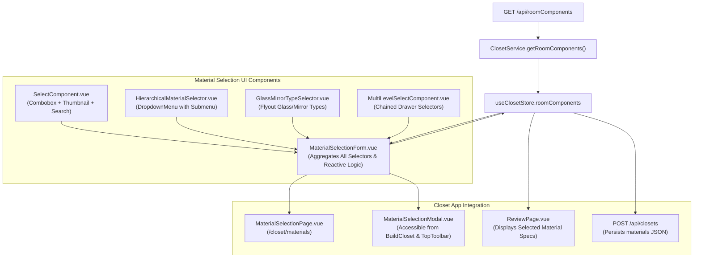
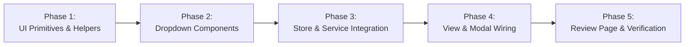

# Material Selection Dropdowns Implementation Plan for Closet App

## 1. Overview & Objective
Implement the exact same material selection dropdown system from **Dia-Website** (`/room/new` and `/room/[id]/edit`) into the **Closet App** (`H:\Vue\Closet`).

This includes:
- Exact visual style (card-style combobox triggers with image thumbnails, titles, subtitles, and chevron icons, matching dark theme).
- Hierarchical dropdowns (e.g., *Finished Interior* parent with subcategories).
- Dependent and hidden dropdowns (conditionally rendered based on upstream selections).
- Dependency validation & auto-reset cascade (clearing or checking downstream items when parent selections change).
- Integration into the Closet App data layer, state store, backend sync, and review page.

---

## 2. Dropdown Catalog & Dependency Rules

| Dropdown | Target Property | Component Type | Visibility Condition | Data Source & Filtering | Auto-Reset / Validation Rules |
| :--- | :--- | :--- | :--- | :--- | :--- |
| **Box Material** | `box_materials` | `HierarchicalMaterialSelector` | Always visible | `roomComponents.box_materials`<br>• Parent ID `7` (*Finished Interior*)<br>• Children IDs `[8..18]` in submenu<br>• Regular options top-level | • Resets `box_material_colors` to `null`<br>• Validates `drawer_types`: resets drawer if not compatible with new box material |
| **Box Material Color** | `box_material_colors` | `SelectComponent` | **Hidden/Dependent**:<br>Only shown if `hasBoxMaterialColors(box_materials)` (IDs: `[5, 8..18]`) | `roomComponents.box_material_colors`<br>Filtered by `box_material_id === box_materials.id` | None |
| **Door Type** | `door_types` | `SelectComponent` | Always visible | `roomComponents.door_types` | • Resets `door_finish_materials` = `null`<br>• Resets `door_finish_material_colors` = `null`<br>• Resets `glass_or_mirror` = `null`<br>• Resets `glass_mirror_type` = `null` |
| **Door Material** | `door_finish_materials` | `SelectComponent` | **Hidden/Dependent**:<br>Only shown if `door_types` is selected | `roomComponents.door_finish_materials`<br>Filtered by `door_type_id === door_types.id` | • Resets `door_finish_material_colors` = `null`<br>• Resets `glass_or_mirror` = `null`<br>• Resets `glass_mirror_type` = `null`<br>• Validates `drawer_types`: resets drawer if door finish material has restrictive style IDs (`[140, 131, 132, 170]`) |
| **Glass / Mirror & Type** | `glass_or_mirror`, `glass_mirror_type` | `GlassMirrorTypeSelector` | **Hidden/Dependent**:<br>Only shown if `door_types.id === 7` (*Glass Doors*) | `roomComponents.glass_mirror_types` & `glass_mirror_options`<br>Allows both Glass & Mirror if `door_finish_materials.id === 57` (*Aluminum Glass Door*); otherwise Glass only | Must select Door Material first (displays toast if clicked prior) |
| **Door Color** | `door_finish_material_colors` | `SelectComponent` | **Hidden/Dependent**:<br>Only shown if `door_finish_materials` is selected | `roomComponents.door_finish_material_colors`<br>Filtered by `door_finish_material_id === door_finish_materials.id` | Validates `grains`: if selected grain is no longer valid for new color, resets `grains` = `null` |
| **Door Grain** | `grains` | `SelectComponent` + Status Banner | **Hidden/Dependent**:<br>Only shown if `door_finish_material_colors` is selected | `roomComponents.grains`<br>Filtered by `has_grain` & `only_vertical_grain` flags:<br>• `has_grain = 0`: Only `N/A` (ID 1)<br>• `only_vertical_grain = 1`: Only `Vertical` (ID 2)<br>• `only_vertical_grain = 0`: `Vertical` (ID 2) + `Horizontal (Upcharge)` (ID 4) | Informational banner displays above selector with dynamic state description |
| **Drawer Type & Material** | `drawer_types`, `drawer_materials` | `MultiLevelSelectComponent` | **Prerequisite Gated**:<br>Requires both `box_materials` AND `door_finish_materials` | `roomComponents.drawer_types` (filtered) & `roomComponents.drawer_materials` (filtered by `drawer_type_id`)<br>• Finished Interior special drawer (ID 12) excluded if box material is not finished interior<br>• Excluded drawer IDs `[1, 2, 3, 9, 13, 14]` if door style is restrictive | If prerequisites not met, renders disabled placeholder cards instructing user what to select first |

---

## 3. Architecture & Technical Breakdown



### 3.1 Prerequisite UI Primitives (Radix Vue)
`H:\Vue\Closet` already has `radix-vue`, `clsx`, `tailwind-merge`, and `lucide-vue-next` installed. We will add the required shadcn-style UI primitives to `src/components/ui`:
- `popover`: `Popover.vue`, `PopoverTrigger.vue`, `PopoverContent.vue`
- `command`: `Command.vue`, `CommandInput.vue`, `CommandList.vue`, `CommandEmpty.vue`, `CommandGroup.vue`, `CommandItem.vue`
- `dropdown-menu`: `DropdownMenu.vue`, `DropdownMenuTrigger.vue`, `DropdownMenuContent.vue`, `DropdownMenuItem.vue`, `DropdownMenuSub.vue`, `DropdownMenuSubTrigger.vue`, `DropdownMenuSubContent.vue`
- `label`: `Label.vue`
- `tabs` (optional for multi-closet tabs): `Tabs.vue`, `TabsList.vue`, `TabsTrigger.vue`, `TabsContent.vue`

### 3.2 Service & Composable Layer
Port and adapt from Dia-Website:
1. `src/services/ClosetService.ts`: Add `getRoomComponents()` endpoint query to `/roomComponents`.
2. `src/features/closet/domain/materials/materialConstants.ts`:
   - Material IDs, restrictive styles, finished interior IDs, grain flags, validation messages.
3. `src/composables/useMaterialHelpers.ts`:
   - Filter functions for box colors, drawer types, grains, default material structure, and completeness validation.
4. `src/composables/useGrainSelector.ts`:
   - Grain filtering and validation based on color grain properties.
5. `src/composables/useGlassMirrorSelector.ts`:
   - Parent/child resolution for glass and mirror types.

### 3.3 Pinia Store & Schema Updates
1. `src/features/closet/domain/types/material.ts`:
   - Define `RoomMaterials` interface:
     ```ts
     export interface RoomMaterials {
       box_materials: any | null
       box_material_colors: any | null
       door_types: any | null
       door_finish_materials: any | null
       glass_or_mirror: any | null
       glass_mirror_type: any | null
       door_finish_material_colors: any | null
       grains: any | null
       drawer_types: any | null
       drawer_materials: any | null
     }
     ```
2. `src/stores/useClosetStore.ts`:
   - Add `roomComponents` state and `loadRoomComponents()` action.
   - Update `materials` in state to use `RoomMaterials` (preserving backward compatibility with existing closet records).
   - Ensure `syncCurrentCloset()`, `openClosetDesign()`, and localStorage persistence properly handle the full `RoomMaterials` payload.
3. `src/features/closet/domain/schema.ts`:
   - Update `exportForBackend` to include `materials`.

---

## 4. User Experience & Placement Options

We recommend offering dual access for maximum flexibility:
1. **Flow Step**:
   - Navigation flow: **Select Closet Type** $\rightarrow$ **Floor Plan** $\rightarrow$ **Materials** (`/closet/materials`) $\rightarrow$ **Build Closet** $\rightarrow$ **Review**.
   - Includes the exact page layout from the screenshot (Closet name with edit icon, room tab, dropdown cards, and "Proceed to Build Closet" button).
2. **In-Builder Quick Access**:
   - Add a "Materials" button in `TopToolbar` and/or a "Closet Materials" button in `BuildCloset.vue` that opens a slide-over drawer or dialog so the user can modify materials without losing their builder context.
3. **Review Page Display**:
   - Update `ReviewPage.vue` summary card to display the selected Box Material, Door Type, Door Material, Door Color, Grain, and Drawers with preview thumbnails.

---

## 5. Implementation Phases



- **Phase 1: UI Primitives & Domain Logic**
  - Create `popover`, `command`, `dropdown-menu`, `label` in `src/components/ui/`.
  - Create `materialConstants.ts`, `useMaterialHelpers.ts`, `useGrainSelector.ts`, `useGlassMirrorSelector.ts`.
- **Phase 2: Core Dropdown Components**
  - Implement `SelectComponent.vue` with search, image thumbnail, and checkmark.
  - Implement `HierarchicalMaterialSelector.vue` with nested submenu.
  - Implement `GlassMirrorTypeSelector.vue`.
  - Implement `MultiLevelSelectComponent.vue`.
  - Assemble `MaterialSelectionForm.vue`.
- **Phase 3: Store & Service Wiring**
  - Add `getRoomComponents` to `ClosetService.ts`.
  - Update `useClosetStore.ts` with `loadRoomComponents()` and material management actions.
  - Update `schema.ts` and `material.ts` types.
- **Phase 4: Views & Routing**
  - Create `MaterialSelectionPage.vue` matching the screenshot.
  - Add route `/closet/materials` in `src/router/index.ts`.
  - Add Materials button / modal trigger to `TopToolbar.vue` and `BuildCloset.vue`.
  - Update footer navigation forward/back links.
- **Phase 5: Review Summary & Testing**
  - Update `ReviewPage.vue` to show real material selections.
  - Write Vitest tests for material helpers, grain selection, and drawer filtering.
  - Verify visually in the browser against the user's screenshot.
